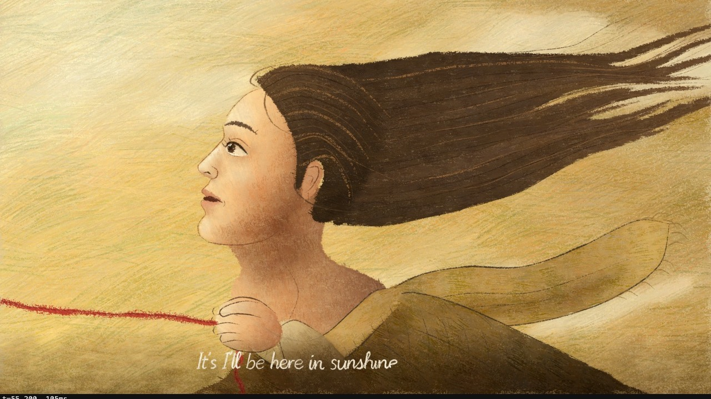
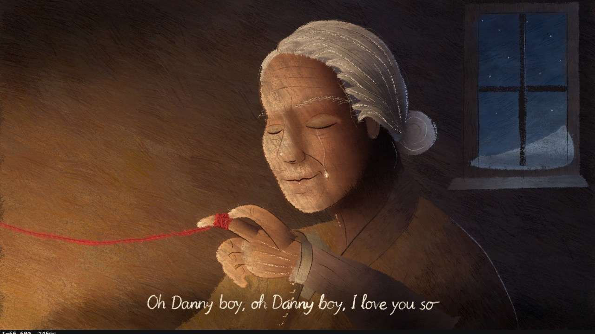
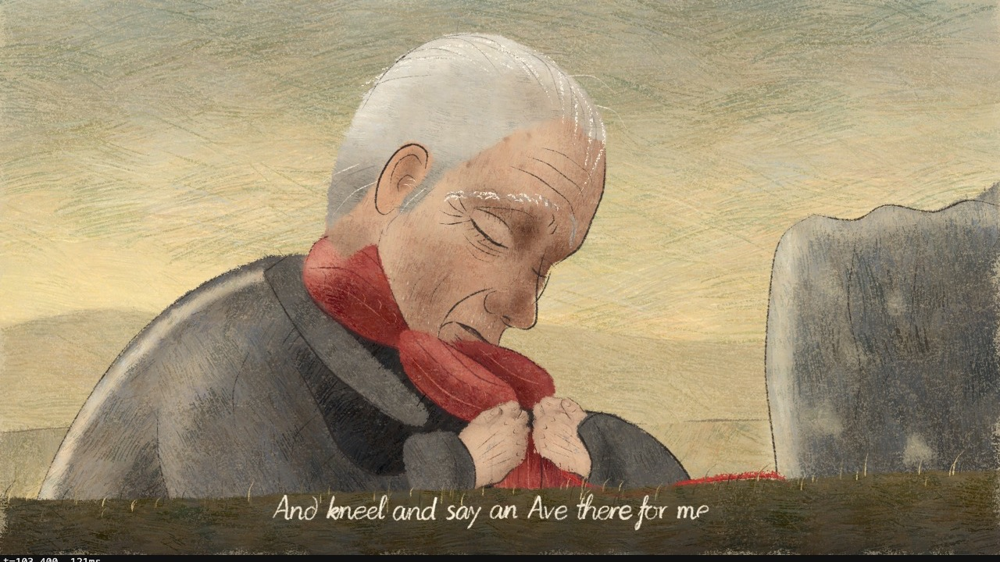
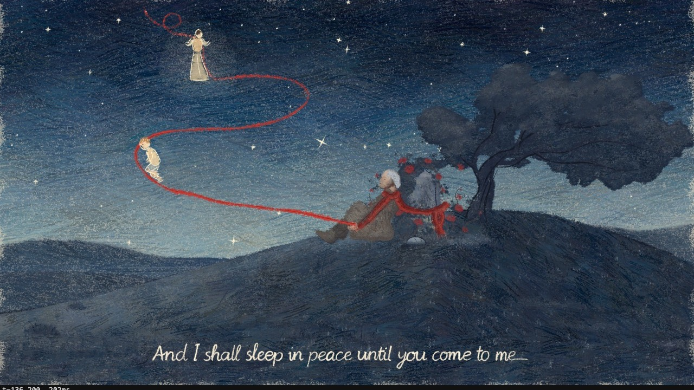

# bide

*Danny Boy*, sung by a voice written in plain Python and drawn by hand in code. One HTML file, 2 minutes 32 seconds.

Download [`dist/bide.html`](dist/bide.html), open it in Chrome, press the ball of red wool, sound on.


## What it is made of

| part | how | where |
|---|---|---|
| **voice** | a vocal tract simulated as a tube of air: glottis, throat, mouth, nose and lips, moved by a jaw, a tongue, lips and a velum | `voice/` |
| **performance** | melody, words, phonemes, breaths, vibrato, rubato, loudness | `music/` |
| **band** | a plucked-string harp, bowed strings, a low whistle and far-off pipes, all modelled | `band/` |
| **mix** | a stone room, ducking, loudness, and a FLAC encoder | `mix/` |
| **film** | a WebGL2 engine that repaints every sheet in pastel, pencil and graphite on toothy paper, 12 drawings a second | `film/engine.js` |
| **people and places** | poseable drawings of a mother and her son across a lifetime; glens, weather, a cottage, a thorn tree, the red thread | `film/cast.js`, `film/world.js` |
| **19 shots** | staged and timed to the sung words, lyrics handwritten as they are sung | `film/scenes/` |

Python standard library only. Plain JavaScript only. No text-to-speech, no samples, no recordings, no machine-learning model, no fonts, no images, no CDN. The page makes no network request.

## The story

A mother knits a red scarf for her son. He leaves, and it unravels one red thread behind him across the glens. She keeps the other end all her life. When he is old he follows it home, to a stone under a thorn tree. Under the earth she still holds the end of it.

The thread is the pencil line itself: the first mark on the paper and the last one.

| | |
|---|---|
|  |  |
|  |  |
|  |  |

## Build it

```bash
./make.sh
```

Made and run on Python 3.13, nothing to install. It renders the voice, the band and the mix, encodes the song and writes `dist/bide.html`. Every random choice is seeded.

One step at a time:

```bash
python3 music/perform.py                                   # score -> performance (build/perf.json)
python3 voice/sing.py --lines 6 --out build/line6.wav      # hear one line of the raw voice
python3 voice/sing.py --all --out build/voice.wav          # the whole song, about a minute
python3 band/render.py                                     # harp, strings, whistle, pipes
python3 mix/mix.py build/voice.wav -o build/mix.wav
python3 mix/flac.py build/mix.wav build/song.flac --requant --max-bytes 9000000
python3 tools/build.py                                     # everything into one HTML file
```

`film/dev.html` opens the film without sound. `tools/shot.mjs` and `tools/record.mjs` (Node, Chrome, macOS) capture stills and video.

## How the voice works

`music/score.py` holds the tune, the words as phonemes, and a mood for each line. `music/perform.py` turns that into a performance: glides, scoops, vibrato that starts late and differs per word, breaths, and a singer who lingers on the words that matter while the band stays in time.

`voice/gest.py` turns phonemes into overlapping movements of the articulators. `voice/tract.py` turns articulators into an area function: how wide the tract is at every point from the glottis to the lips. `voice/tube.py` runs sound through that tube, with losses, a nose and radiation at the lips. `voice/glottis.py` makes the glottal pulses and `voice/engine.py` gives them jitter, shimmer and breath that pulses with them. `voice/fit.py` found the vowel shapes by searching for tongue and lip positions whose resonances match each vowel.

While it was being built, macOS's on-device speech recogniser and sound classifier listened to each take. The final dry take reads 95% of the words in order, and 56% with the words shuffled so it cannot lean on knowing the song. A system text-to-speech voice was used only as a yardstick for those listeners; none of it is in the code or the song.

## Keys

Space pauses. Left and right skip five seconds. R restarts. F is fullscreen. M mutes.

## Credits

Tune: *Londonderry Air*, traditional. Words: Frederic Weatherly, 1913, public domain.
Made by [ChetasLua](https://github.com/ChetasLua) with Claude Opus 5.5 and a crew of subagents.

MIT license.
