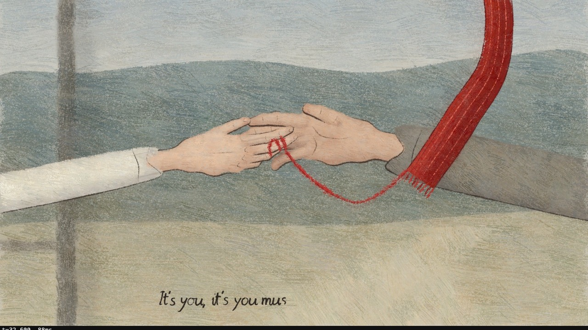
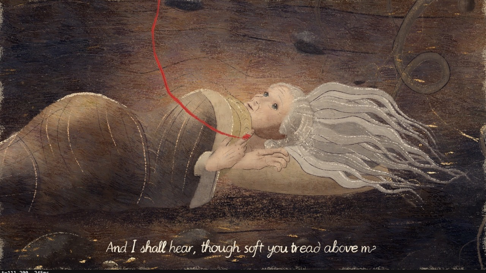
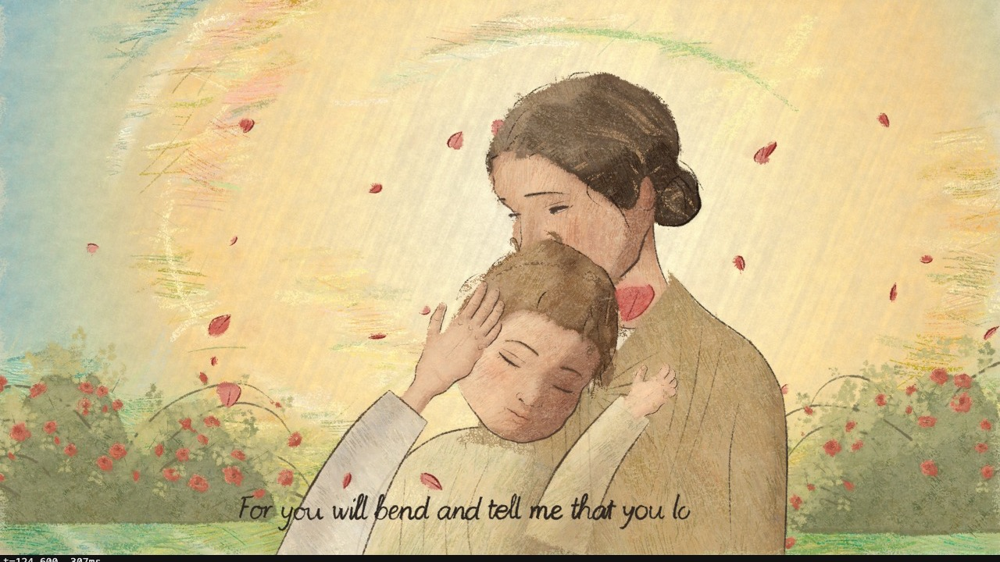

# bide

*Danny Boy*, sung by a voice written in Python and drawn by hand in code. One HTML file, 2 minutes 32 seconds.

Download `bide_<version>.html` from the [releases page](https://github.com/angloc/concert/releases), open it in a current browser, press the ball of red wool, sound on.

## What it is

The singer is a woman, middle-aged in the first verse, ageing through the second, and singing from the grave in the last lines. The song is in G major, four semitones above the original E flat, and the band moves with her.

| part | how | where |
|---|---|---|
| **voice** | a vocal tract simulated as a tube of air: glottis, throat, mouth, nose and lips, moved by a jaw, a tongue, lips and a velum | `src/concert/voice/` |
| **singers, accent, song** | singer profiles, an Irish accent over lexical sets, the Danny Boy lexicon and key | `singers/`, `accents/`, `songs/`, `key.json` |
| **performance** | melody, words, connected speech, breaths, vibrato, rubato, loudness | `src/concert/performance/`, `src/concert/diction/` |
| **band** | a plucked-string harp, bowed strings, a low whistle and far-off pipes, all modelled | `src/concert/band/` |
| **mix** | a stone room, ducking, loudness, and a FLAC encoder | `src/concert/mix/` |
| **film** | a WebGL2 engine that repaints every sheet in pastel, pencil and graphite on toothy paper, 12 drawings a second | `film/engine.js` |
| **people and places** | poseable drawings of a mother and her son across a lifetime; glens, weather, a cottage, a thorn tree, the red thread | `film/cast.js`, `film/world.js` |
| **19 shots** | staged and timed to the sung words, lyrics handwritten as they are sung | `film/scenes/` |

No text-to-speech, no samples, no recordings, no machine-learning model, no fonts, no images, no CDN. The page makes no network request.

## The story

A mother knits a red scarf for her son. He leaves, and it unravels one red thread behind him across the glens. She keeps the other end all her life. When he is old he follows it home, to a stone under a thorn tree. Under the earth she still holds the end of it.

The thread is the pencil line itself: the first mark on the paper and the last one.

| | |
|---|---|
|  |  |
|  |  |
|  |  |

## Keys

Space pauses. Left and right skip five seconds. R restarts. F is fullscreen. M mutes.

## Developing

Work in the devcontainer (`.devcontainer/`), or in a dedicated virtual machine where `DEDICATED_ENVIRONMENT=1` is set. Then:

| Target | What it does |
|---|---|
| `make install` | installs uv and the locked Python environment; refuses to run outside CI, a container or a dedicated machine |
| `make verify` | the check to run before finishing any change: formatting, lint, vulnerability audit, tests, coverage and the documentation check |
| `make package` | builds the page from nothing into `dist/bide_<version>.html` with `SHA256SUMS`; takes a few minutes |
| `make test` | packages, then runs the tests |
| `make export` | packages, then draws the whole film in headless Chromium and writes it with the song to `build/bide.mp4` (1920×1080, 24 fps); takes hours without a GPU |
| `make fmt` | formats the Python code |
| `make docs-check` | checks the knowledge base, decision records, plan and links |

Every random choice is seeded, so the same source and `VERSION_TAG` give a byte-identical page.

Start with [AGENTS.md](AGENTS.md) and [POLICY.md](POLICY.md), then the [knowledge base](docs/knowledge/index.md) and the [plan](PROJECT_PLAN.md).

## Credits

Tune: *Londonderry Air*, traditional. Words: Frederic Weatherly, 1913, public domain.
Made by [ChetasLua](https://github.com/ChetasLua) with Claude Opus 5.5 and a crew of subagents. Female voice, accent, lexicon and the work since by [angloc](https://github.com/angloc).

MIT licence; see [LICENSE](LICENSE).
