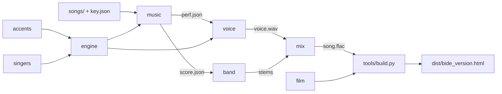
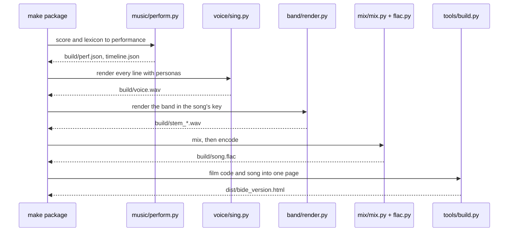

# Architecture

bide renders a song from nothing: a score, a physical model of a singing voice, modelled instruments, a mix, and a hand-drawn film, all assembled into one HTML file that plays offline. Every random choice is seeded, so a build is reproducible byte for byte.

The current directory layout predates the Python profile. Each top-level directory below is one module, and modules reach each other through `sys.path`. The move to `src/` is increment I3 in [PROJECT_PLAN.md](../../PROJECT_PLAN.md), under the transitional exception in [decision 0015](../decisions/0015-transitional-compliance.md).

## Structure

The build is a pipeline of files. Data folders (songs, singers, accents, key) are read by the modules that need them.

Caption: data and modules feed one another through files in `build/`, ending in a single page.

## Behaviour

`make package` runs the stages in order. Each stage reads the previous stage's files in `build/` and writes its own.

Caption: one build, stage by stage, with the files each stage hands on.

## Modules

### Song data

Hides what a particular song is: its words in lexical-set notation (`songs/<name>/lexicon.txt`) and the key it is sung in (`key.json`, a shift in semitones read by both voice and band). Song data only: no engine code. Decisions: [0006](../decisions/0006-lexical-sets.md), [0007](../decisions/0007-songs-and-singers-in-folders.md). Code: [songs/](../../songs/), [key.json](../../key.json).

The tune, syllables and moods of Danny Boy still live in `music/score.py`, and the Danny Boy personas in `voice/persona.py`; see [open questions](open-questions.md). In the approved design a song is a score, an arrangement and a performance file, all in `songs/<name>/` ([description model](description/model.md); not yet built).

### Singers

Hides who is singing: tract scale and source settings for each singer, in `singers/<name>/profile.json`. A persona in a song is an overlay on a profile. Range, registers, breath and per-singer permissions are designed but not yet built, and so is a profile stated in measurable quantities from which the engine settings are derived ([decision 0020](../decisions/0020-measurable-singer-profiles.md)); see [singer profile](singer-profile.md). Decision: [0007](../decisions/0007-songs-and-singers-in-folders.md). Code: [singers/](../../singers/), loader [engine/singer.py](../../engine/singer.py).

### Accents

Hides how an accent pronounces lexical sets: a map from each set to the phones the voice knows, with optional consonant rewrites, in `accents/<name>/accent.json`. Decisions: [0008](../decisions/0008-accent-plug-in.md), [0009](../decisions/0009-goat-monophthong.md). Code: [accents/](../../accents/).

### Score

Not yet built (increment I11). Hides how a written score is read: ABC through abc2xml, MusicXML through music21, into one score model in metric time with parts, notes, words, marks and chord symbols; a chord-symbol parser of the project's own; MusicXML export; and the score check that runs before rendering. Interface: a score model for the performance and band. Decisions: [0016](../decisions/0016-score-format.md), [0017](../decisions/0017-chord-symbols.md). Intended code: `score`, under `src/`. See [description model](description/model.md).

### Tempo map

Not yet built (increment I13). Hides how metric time becomes seconds: one map, produced by the performance, through which the voice, band, mix and film timeline find every position. Decision: [0018](../decisions/0018-metric-clock.md). Intended code: `tempo`, under `src/`.

### Engine

Hides the song-neutral language rules: turning lexicon words into sung syllables through an accent ([engine/lexicon.py](../../engine/lexicon.py)), the connected-speech catalogue and its rule functions ([engine/connected.py](../../engine/connected.py), [engine/connected_speech.json](../../engine/connected_speech.json)), the experiment switches read from `BIDE_LEGATO` ([engine/opts.py](../../engine/opts.py)) and singer loading. Interface: functions called by `music/perform.py` and `voice/`. Code: [engine/](../../engine/).

### Music

Hides the score and how a human performs it. `music/score.py` holds tempo, melody, syllables, phonemes, harmony and a mood per line. `music/perform.py` turns the score into a performance: glides, scoops, late and varied vibrato, breaths, rubato, and connected-speech reductions. Interface: `build/score.json`, `build/perf.json` (control tracks at 200 Hz, phoneme segments, breaths) and `build/timeline.json` for the film. Code: [music/](../../music/). Not yet built: a rule layer that derives the performance from the score through weighted rules, mood presets and overrides ([decision 0019](../decisions/0019-performance-rules.md)).

### Voice

Hides the physics of the singing voice. See [voice model](voice-model.md). Entry point `voice/sing.py` renders lines or the whole song to a WAV file, with `--persona` for the per-line Danny Boy personas and `--singer` for a plain profile. Interface: `build/perf.json` in, `build/voice.wav` out. Code: [voice/](../../voice/).

### Band

Hides the instruments: a plucked-string lever harp with sympathetic strings, bowed strings, a low wooden whistle and far-off pipe drones, each a physical model, placed by `band/arrange.py` on the singer's rubato clock. `band/dsp.py` is the shared signal toolbox. Key-aware decisions (which notes rub, which are bass) stay in the original key; only the synthesis calls are shifted. Interface: `build/score.json` in, `build/stem_*.wav` and `build/band.wav` out. Code: [band/](../../band/). Not yet built: a player model for each instrument family that plays a part written as a score, and instrument instances as data in `instruments/<name>/` ([decision 0019](../decisions/0019-performance-rules.md)).

### Mix

Hides how the parts become one recording: a linear mix with slow gains and one stone-chapel room (`mix/mix.py`, `mix/room.py`), and a pure-Python FLAC encoder that requantises gently when the file must fit a size limit (`mix/flac.py`). Interface: `build/voice.wav` and stems in, `build/mix.wav` and `build/song.flac` out. Code: [mix/](../../mix/).

### Film

Hides how the picture is drawn: a WebGL2 and Canvas2D engine that paints pastel, pencil and graphite on toothy paper, with a 2D fallback when WebGL2 is missing; poseable people; places, weather and the red thread; handwriting; 19 scenes; and the player, whose clock is the song. Interface: the `BIDE` global; see [film](film/index.md). `film/dev.html` opens the film without sound, for development. The JavaScript profile does not apply here ([decision 0012](../decisions/0012-film-exception.md)). Code: [film/](../../film/).

### Page assembly

Hides how the film and song become one self-contained page with nothing fetched. `tools/build.py` inlines the film code and the song (as base64 FLAC). `tools/mktimeline.py` turns the performance timeline into film data. Interface: `build/` in, one HTML file out. Code: [tools/build.py](../../tools/build.py), [tools/mktimeline.py](../../tools/mktimeline.py).

### Review and capture tools

- `tools/preflight.py`: a read-only review of a render against the voice's physical limits (pitch against F1, harmonic spacing, presence, level over the band, consonant energy) per vowel nucleus. Writes no audio. The plan-check half of preflight is not yet built ([performance feasibility](performance/feasibility.md)).
- `tools/shot.mjs`: captures stills of test sheets and scenes in headless Chrome.
- `tools/record.mjs` with `tools/enc.swift`: draws every sheet in headless Chrome and encodes an MP4 through macOS AVFoundation. To be replaced by ffmpeg ([decision 0011](../decisions/0011-ffmpeg-video-export.md)).

Code: [tools/](../../tools/).

### Repository checks

Hides the repository's own rules: the documentation check (`doccheck`) and the release tag check (`tagcheck`). Interface: command-line programs run by `make docs-check` and the release workflow. Code: [src/repochecks/](../../src/repochecks/).

## Target platforms

One platform: evergreen browsers, desktop and mobile, at Baseline 2025. See [platforms](platforms.md) and [decision 0013](../decisions/0013-browser-target.md).
