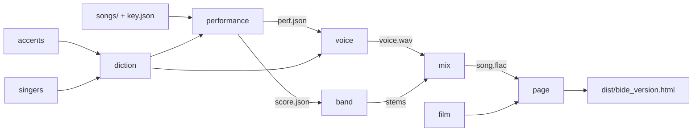
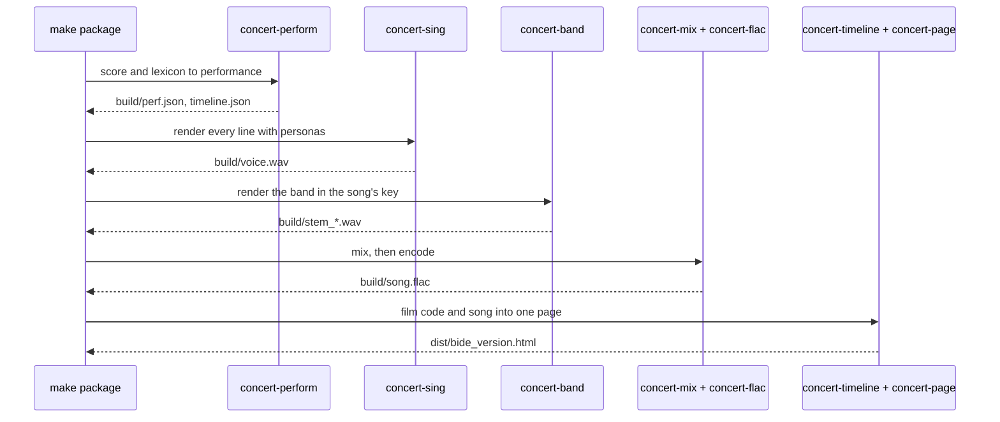

# Architecture

bide renders a song from nothing: a score, a physical model of a singing voice, modelled instruments, a mix, and a hand-drawn film, all assembled into one HTML file that plays offline. Every random choice is seeded, so a build is reproducible byte for byte.

The Python code is one package, `concert`, under `src/concert/`, with one subpackage for each module below. Each command-line stage is a console script (`concert-perform`, `concert-sing` and so on) that calls one `main` function. The data folders (`songs/`, `singers/`, `accents/`, `key.json`), the film (`film/`) and the build directory (`build/`) stay at the repository root, which the package finds as `concert.ROOT`.

## Structure

The build is a pipeline of files. Data folders (songs, singers, accents, key) are read by the modules that need them.

Caption: data and modules feed one another through files in `build/`, ending in a single page.

## Behaviour

`make package` runs the stages in order. Each stage reads the previous stage's files in `build/` and writes its own.

Caption: one build, stage by stage, with the files each stage hands on.

## Modules

### Song data

Hides what a particular song is: its words in lexical-set notation (`songs/<name>/lexicon.txt`) and the key it is sung in (`key.json`, a shift in semitones read by both voice and band). Song data only: no engine code. Decisions: [0006](../decisions/0006-lexical-sets.md), [0007](../decisions/0007-songs-and-singers-in-folders.md). Code: [songs/](../../songs/), [key.json](../../key.json).

The tune, syllables and moods of Danny Boy still live in `src/concert/performance/score.py`, and the Danny Boy personas in `src/concert/voice/persona.py`; see [open questions](open-questions.md). In the approved design a song is a score, an arrangement and a performance file, all in `songs/<name>/` ([description model](description/model.md); not yet built).

### Singers

Hides who is singing: tract scale and source settings for each singer, in `singers/<name>/profile.json`. A persona in a song is an overlay on a profile. Range, registers, breath and per-singer permissions are designed but not yet built, and so is a profile stated in measurable quantities from which the engine settings are derived ([decision 0020](../decisions/0020-measurable-singer-profiles.md)); see [singer profile](singer-profile.md). Decision: [0007](../decisions/0007-songs-and-singers-in-folders.md). Code: [singers/](../../singers/), loader [src/concert/diction/singer.py](../../src/concert/diction/singer.py).

### Accents

Hides how an accent pronounces lexical sets: a map from each set to the phones the voice knows, with optional consonant rewrites, in `accents/<name>/accent.json`. Decisions: [0008](../decisions/0008-accent-plug-in.md), [0009](../decisions/0009-goat-monophthong.md). Code: [accents/](../../accents/).

### Score

Not yet built (increment I11). Hides how a written score is read: ABC through abc2xml, MusicXML through music21, into one score model in metric time with parts, notes, words, marks and chord symbols; a chord-symbol parser of the project's own; MusicXML export; and the score check that runs before rendering. Interface: a score model for the performance and band. Decisions: [0016](../decisions/0016-score-format.md), [0017](../decisions/0017-chord-symbols.md). Intended code: `score`, under `src/`. See [description model](description/model.md).

### Tempo map

Not yet built (increment I13). Hides how metric time becomes seconds: one map, produced by the performance, through which the voice, band, mix and film timeline find every position. Decision: [0018](../decisions/0018-metric-clock.md). Intended code: `tempo`, under `src/`.

### Diction

Hides the song-neutral language rules: turning lexicon words into sung syllables through an accent (`lexicon`), the connected-speech catalogue and its rule functions (`connected`, `connected_speech.json`), the experiment switches read from `BIDE_LEGATO` (`opts`) and singer loading (`singer`). Interface: functions called by the performance and the voice. Code: [src/concert/diction/](../../src/concert/diction/).

### Performance

Hides the score and how a human performs it. `score` holds tempo, melody, syllables, phonemes, harmony and a mood per line. `perform` (`concert-perform`) turns the score into a performance: glides, scoops, late and varied vibrato, breaths, rubato, and connected-speech reductions. Interface: `build/score.json`, `build/perf.json` (control tracks at 200 Hz, phoneme segments, breaths) and `build/timeline.json` for the film. Code: [src/concert/performance/](../../src/concert/performance/). Not yet built: a rule layer that derives the performance from the score through weighted rules, mood presets and overrides ([decision 0019](../decisions/0019-performance-rules.md)).

### Voice

Hides the physics of the singing voice. See [voice model](voice-model.md). Entry point `concert-sing` renders lines or the whole song to a WAV file, with `--persona` for the per-line Danny Boy personas and `--singer` for a plain profile. Interface: `build/perf.json` in, `build/voice.wav` out. `concert-fit` refits the vowel and consonant shapes (`shapes.json`). Code: [src/concert/voice/](../../src/concert/voice/).

### Band

Hides the instruments: a plucked-string lever harp with sympathetic strings, bowed strings, a low wooden whistle and far-off pipe drones, each a physical model, placed by `arrange` on the singer's rubato clock. `dsp` is the shared signal toolbox. Key-aware decisions (which notes rub, which are bass) stay in the original key; only the synthesis calls are shifted. Interface: `build/score.json` in, `build/stem_*.wav` and `build/events.json` out (`concert-band`). Code: [src/concert/band/](../../src/concert/band/). Not yet built: a player model for each instrument family that plays a part written as a score, and instrument instances as data in `instruments/<name>/` ([decision 0019](../decisions/0019-performance-rules.md)).

### Mix

Hides how the parts become one recording: a linear mix with slow gains and one stone-chapel room (`mix`, `room`; `concert-mix`), and a pure-Python FLAC encoder that requantises gently when the file must fit a size limit (`flac`; `concert-flac`). Interface: `build/voice.wav` and stems in, `build/mix.wav`, `build/report.json` and `build/song.flac` out. Code: [src/concert/mix/](../../src/concert/mix/).

### Film

Hides how the picture is drawn: a WebGL2 and Canvas2D engine that paints pastel, pencil and graphite on toothy paper, with a 2D fallback when WebGL2 is missing; poseable people; places, weather and the red thread; handwriting; 19 scenes; and the player, whose clock is the song. Interface: the `BIDE` global; see [film](film/index.md). `film/dev.html` opens the film without sound, for development. The JavaScript profile does not apply here ([decision 0012](../decisions/0012-film-exception.md)). Code: [film/](../../film/).

### Page assembly

Hides how the film and song become one self-contained page with nothing fetched. `build` (`concert-page`) inlines the film code and the song (as base64 FLAC), and writes the version (`--version`, which `make package` takes from `VERSION_TAG`) as visible text in the page shell ([decision 0014](../decisions/0014-version-on-page.md)). `timeline` (`concert-timeline`) turns the performance timeline into film data. Interface: `build/` in, one HTML file out. Code: [src/concert/page/](../../src/concert/page/).

### Review and capture tools

- `concert-preflight <build dir>` ([src/concert/review/](../../src/concert/review/)): a read-only review of a render against the voice's physical limits (pitch against F1, harmonic spacing, presence, level over the band, consonant energy) per vowel nucleus. Writes no audio; writes its rows to `preflight_rows.json` in the build directory. The plan-check half of preflight is not yet built ([performance feasibility](performance/feasibility.md)).
- Capture ([src/concert/capture/](../../src/concert/capture/)) hides how the film is drawn in a headless browser: `film/dev.html` open in Chromium through Playwright at 1920×1080, with SwiftShader where there is no GPU.
  - `concert-shot` draws chosen times (`--at`, `--strip`) or test sheets (`--fn`, `--k`) as one captioned contact sheet, JPEG or PNG.
  - `concert-record out.mp4 song.flac [--from s] [--to s]` draws every drawing in order and streams it as JPEG to ffmpeg, which writes 1920×1080 H.264 at 24 fps (each drawing held for two frames) with the song as AAC ([decision 0011](../decisions/0011-ffmpeg-video-export.md)). `make export` runs it over the whole film into `build/bide.mp4`.

### Repository checks

Hides the repository's own rules: the documentation check (`doccheck`), the release tag check (`tagcheck`) and the Baseline check of the built page (`baselinecheck`). `baselinecheck` splits the page into its markup, styles and scripts and runs ESLint over them with the Baseline rule of each language, from the pinned Node toolchain and configuration in [baseline/](../../baseline/) ([decision 0013](../decisions/0013-browser-target.md), [decision 0022](../decisions/0022-baseline-exceptions.md)). Interface: command-line programs run by `make docs-check`, `make verify` and the release workflow. Code: [src/repochecks/](../../src/repochecks/).

## Target platforms

One platform: evergreen browsers, desktop and mobile, at Baseline 2025. See [platforms](platforms.md) and [decision 0013](../decisions/0013-browser-target.md).
