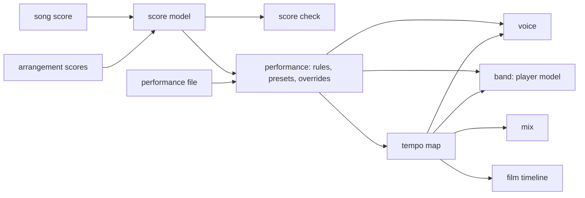

# Description model

Not yet built. This is the approved design; the build plan is increments I11 to I17 in [PROJECT_PLAN.md](../../../PROJECT_PLAN.md).

## Aim

Each thing that varies between renders is described once, as data, at the weight of ordinary musical notation. A song is marked-up words and a tune, plus zero or more instrumental scores. Nothing in a song file is there only because the engine needs it. The engine, voice, band and mix stay song-neutral ([decision 0007](../../decisions/0007-songs-and-singers-in-folders.md)).

Today the song, its interpretation and its arrangement are Python code: the tune, syllables, phones, chords and moods in `src/concert/performance/score.py`; the interpretation tables in `src/concert/performance/perform.py`; the personas in `src/concert/voice/persona.py`; the arrangement in `src/concert/band/arrange.py`. The engine is mostly song-neutral; this description layer is what is missing.

## Entities

| Entity | Holds | Form |
| --- | --- | --- |
| Song | tune, words set under the notes, chord line; lexicon entries for words the shared lexicon lacks | a score in ABC or MusicXML, in `songs/<name>/` |
| Arrangement | the instrumental parts | scores in the same formats, in `songs/<name>/` |
| Performance | casting (singer, accent, instruments), key, personas over spans, tempo map, rule weights, mood presets, overrides, player parameters, mix | a data file in `songs/<name>/`, anchored to score positions |
| Singer | measurable quantities of a voice; personas as presets over it | `singers/<name>/` ([singer profile](../singer-profile.md)) |
| Accent | lexical sets to phones, consonant rewrites, permissions | `accents/<name>/` (built) |
| Instrument | one instance of an instrument family: strings, body, tuning | data in `instruments/<name>/`; each family stays code |

A word's phones come only from the lexicon through the accent. The score holds no phones.

## Score

Scores are written in ABC 2.1 by an AI, or arrive as MusicXML from a notation program. ABC is read through abc2xml into MusicXML, and MusicXML is read with music21, into one score model in metric time ([decision 0016](../../decisions/0016-score-format.md)). Chord symbols are kept as written and parsed by the project ([decision 0017](../../decisions/0017-chord-symbols.md)). The evidence is in [score format evidence](score-format.md).

Positions in the score are named by part, bar and beat, or by syllable index in the words. Overrides and persona spans use these anchors, never times or line-and-word keys.

## Time

The score is in metric time. The performance produces one tempo map from metric time to seconds, and the voice, band, mix and film timeline take every position through it ([decision 0018](../../decisions/0018-metric-clock.md)).

Caption: scores become one model, the performance interprets the model, and every stage finds its time through one tempo map.

## Performance

A performance is rule weights, mood presets and explicit overrides ([decision 0019](../../decisions/0019-performance-rules.md)). The rules start from a subset of the KTH performance rules. An override is a performing-edition mark in the score where notation has one (tenuto, fermata, caesura, hairpin, *senza vibrato*), and an entry in the performance file otherwise. Each mood label is a preset of rule weights and voice colour. Instrumental parts are played by a player model per instrument family.

Danny Boy is migrated first with its current values as overrides, and the page stays byte-identical. Rules then replace overrides, one listening verdict at a time. The number of overrides left is the measure of how much hand-tuning the model still needs.

## Checks

A score check runs before rendering: bar lengths against the metre, notes outside the key and the chord, syllables per word against the lexicon, each part against the chord line, and each part's range against its singer or instrument. It warns by default and refuses in strict mode, as preflight does. It is the safety net for scores written by an AI.

## Relation to current code

| Now | In the description model |
| --- | --- |
| `src/concert/performance/score.py`: tune, syllables, ARPAbet phones, `CH`, moods, `FEEL` | song score; phones from the lexicon; chord line in the score; moods and stretches in the performance |
| `src/concert/performance/perform.py`: `LATE`, `CUT`, `VIB`, `ARC`, `COL`, line-specific code | rules, presets and overrides in the performance |
| `src/concert/voice/persona.py` | personas as presets over the singer, spans in the performance |
| `src/concert/band/arrange.py` | arrangement scores, player model and player parameters |
| absolute seconds in `src/concert/performance/score.py`, `src/concert/band/arrange.py`, `src/concert/mix/mix.py` | bars, through the tempo map |
| `singers/<name>/profile.json` engine settings | measurable quantities; engine settings derived ([decision 0020](../../decisions/0020-measurable-singer-profiles.md)) |
